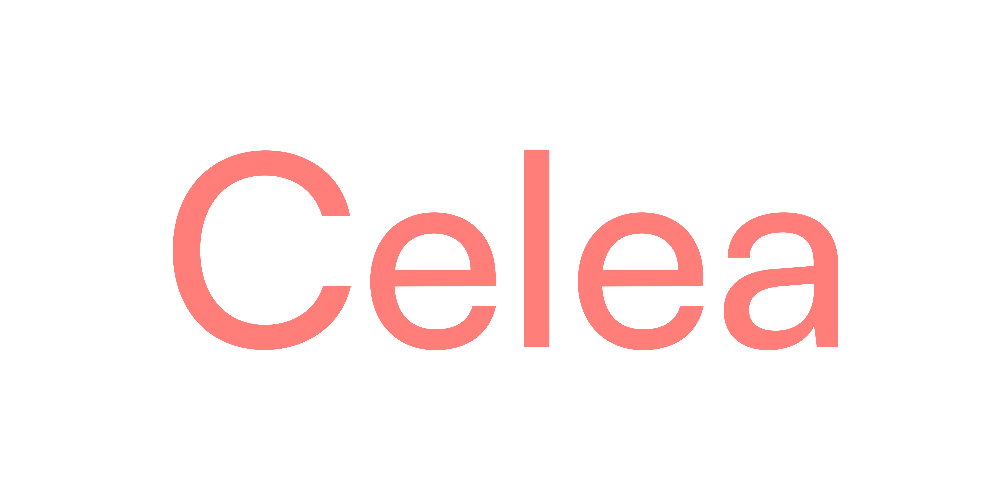

# Celea



Celea is an invite-only web app that generates short videos from a text prompt and then reviews and refines them in a loop. Gemini rewrites your prompt for Veo, Veo renders the clip, and Gemini watches the result and checks it against your original goal. If the clip falls short, Gemini refines the prompt and the loop runs again, up to 5 iterations.

> **Model status (November 2026):** Google shut down the Veo 3.1 *preview* models on the Gemini API on Oct 22, 2026. Video generation (`VEO_MODEL`, default `veo-3.1-generate-preview`) will fail until you point it at a video model your key can reach. Google's suggested replacement, Gemini Omni Flash, uses a different API, so moving to it needs code changes in `src/lib/ai/veo.ts`. The text and video-analysis model is set by `GEMINI_MODEL` and defaults to `gemini-3.8-flash`, Google's listed replacement for the deprecated `gemini-2.5-pro`.

## Features

- **Prompt enhancement:** Gemini turns a rough prompt, plus up to 3 optional reference images, into a detailed video prompt.
- **Video generation:** Veo generates the clip with your chosen aspect ratio (16:9 or 9:16), resolution (720p or 1080p) and duration (4, 6 or 8 s). Reference images are sent as "asset" references. The finished video is stored in Supabase Storage.
- **Quality analysis and auto-refinement:** Gemini watches each generated video and answers yes or no, with an explanation, to whether it meets your goal. On "no" it refines the prompt and tries again, up to 5 iterations.
- **Live progress:** the project page streams job status over Server-Sent Events (`/api/job-status/[id]`).
- **Projects:** group jobs into projects. You can rename and delete jobs and projects, and download videos.
- **Invite gate:** `/projects` and all app APIs need a valid invite code. Codes come from `INVITE_CODES`, and access is kept in a signed, HTTP-only cookie.
- **Waitlist:** visitors without a code can join a waitlist. An admin API lists entries as JSON or CSV and lets you update or delete them.
- **Background jobs:** in production on Vercel, or with `USE_INNGEST=true`, the pipeline runs as an Inngest function because one run takes several minutes. Otherwise it runs in-process.

## Tech stack

| Area | Choice |
| --- | --- |
| Framework | Next.js 16 (App Router, Turbopack), React 19, TypeScript |
| UI | Tailwind CSS v4, shadcn/ui (Radix), lucide-react |
| State | React state (a Zustand store exists in `src/stores` but is not wired into the pages yet) |
| Database | PostgreSQL (Supabase) via Prisma 5 |
| File storage | Supabase Storage (bucket `celea-media`) |
| Background jobs | Inngest |
| AI | Google Gemini API (REST): Gemini for text and video analysis, Veo for video |
| Validation | Zod |

## Architecture

```
Browser (/projects/[id])
   │ POST /api/upload            → Supabase Storage (reference images)
   │ POST /api/pipeline          → creates Job (Prisma) and starts the pipeline
   │ GET  /api/job-status/[id]   ← SSE progress
   ▼
Pipeline (src/lib/pipeline-runner.ts in-process, or src/inngest/functions.ts on Inngest)
   1. enhancePrompt     (src/lib/ai/gemini.ts)  ── Gemini generateContent
   2. generateVideo     (src/lib/ai/veo.ts)     ── Veo predictLongRunning → poll → upload to Supabase
   3. analyzeVideo      (src/lib/ai/gemini.ts)  ── Gemini with the video attached
   4. refinePrompt and repeat (max 5) until analysis says "yes"
   Each step writes Iteration rows to Postgres.
```

`src/proxy.ts` (Next.js 16's replacement for `middleware.ts`) enforces the invite gate. It redirects pages to `/invite` and returns 401 from APIs when the cookie is missing or invalid. Server-side downloads of reference images and videos only accept `https` URLs on your Supabase host or `generativelanguage.googleapis.com` (`src/lib/media-url.ts`).

## Environment variables

Copy `.env.example` to `.env.local` and fill it in.

| Variable | Required | Description |
| --- | --- | --- |
| `DATABASE_URL` | yes | Supabase Postgres pooled connection string (port 6543, `pgbouncer=true`) |
| `DIRECT_URL` | yes | Direct Postgres connection, used by `prisma db push` |
| `NEXT_PUBLIC_SUPABASE_URL` | yes | Supabase project URL; also sets the allowed media host |
| `NEXT_PUBLIC_SUPABASE_ANON_KEY` | yes | Supabase anon key |
| `SUPABASE_SERVICE_ROLE_KEY` | yes | Supabase service-role key, used server-side for storage uploads |
| `GOOGLE_AI_API_KEY` | yes | Google AI Studio API key (Gemini + Veo) |
| `INVITE_SECRET` | yes in production | Secret for signing the invite cookie. Without it, production refuses all invites (fails closed). |
| `INVITE_CODES` | yes | Comma-separated 6-character alphanumeric invite codes |
| `ADMIN_API_KEY` | for admin API | Protects `/api/admin/waitlist` |
| `GEMINI_MODEL` | no | Gemini model id (default `gemini-3.8-flash`) |
| `VEO_MODEL` | no | Veo model id (default `veo-3.1-generate-preview`; see the model status note above) |
| `INNGEST_EVENT_KEY` / `INNGEST_SIGNING_KEY` | production | Inngest app keys |
| `USE_INNGEST` | no | `true` runs the pipeline through Inngest locally |

## Getting started

Prerequisites: Node.js 20.9 or newer (tested on Node 26), a Supabase project, and a Google AI API key.

```bash
git clone https://github.com/SAMARTHJAISWAL/celea.git
cd celea
npm install                 # also runs `prisma generate`
cp .env.example .env.local  # fill in the values
npx prisma db push          # create tables in your Supabase database
npm run dev                 # http://localhost:3000
```

In the Supabase dashboard, create a **public** storage bucket named `celea-media`. Then open `/invite` and enter one of your `INVITE_CODES`.

The project used to use Bun (`bun.lockb`); it now uses npm with a `package-lock.json`.

## Scripts

| Script | What it does |
| --- | --- |
| `npm run dev` | Start the dev server |
| `npm run build` | `prisma generate` + production build |
| `npm start` | Serve the production build |
| `npm run lint` | ESLint (Next.js config) |
| `npm run typecheck` | `tsc --noEmit` |
| `npm test` | Unit tests (Node's built-in test runner) for the invite gate and URL allow-list |
| `npm run db:push` | Push the Prisma schema to the database |

GitHub Actions (`.github/workflows/ci.yml`) runs lint, typecheck, tests and build on every push and pull request.

## API routes

Every route except those marked *public* needs the invite cookie.

| Method | Route | Purpose |
| --- | --- | --- |
| POST | `/api/verify-invite` | *public*: check an invite code and set the signed cookie |
| POST | `/api/waitlist` | *public*: join the waitlist (`{ email }`) |
| GET, PATCH, DELETE | `/api/admin/waitlist` | List (`?format=csv`, `?status=`), update or delete waitlist entries. Needs the `x-admin-key` header (or the legacy `?key=`) |
| GET, POST | `/api/projects` | List or create projects |
| GET, PATCH, DELETE | `/api/projects/[id]` | Get a project with its jobs, rename it, or delete it |
| PATCH, DELETE | `/api/jobs/[id]` | Rename or delete a job |
| POST | `/api/upload` | Upload up to 3 reference images (JPEG/PNG/WebP/GIF, 10 MB each) |
| POST | `/api/pipeline` | Create a job and start the generate/analyze/refine pipeline |
| GET | `/api/job-status/[id]` | Job status; SSE stream with `Accept: text/event-stream` |
| GET | `/api/video/[id]` | Stream or download (`?download=true`) a generated video |
| POST | `/api/enhance-prompt` | Run only the prompt-enhancement step |
| POST | `/api/generate-video` | Run only the Veo generation step |
| POST | `/api/analyze-video` | Run only the Gemini analysis step |
| GET, POST, PUT | `/api/inngest` | Inngest endpoint; requests are signed by Inngest |

## Deployment

See [DEPLOYMENT.md](DEPLOYMENT.md) for the Vercel + Supabase + Inngest setup. Set `INVITE_SECRET`, `INVITE_CODES` and `ADMIN_API_KEY` in production as well.

## Project structure

```
prisma/schema.prisma        Project, Job, Iteration, ReferenceImage, Waitlist
src/proxy.ts                Invite gate for /projects and /api
src/app/
  page.tsx                  Landing page
  invite/page.tsx           Invite code + waitlist form
  projects/page.tsx         Project list
  projects/[id]/page.tsx    Generation workspace (prompt, settings, iterations, player)
  api/                      Route handlers (see table above)
src/lib/
  ai/gemini.ts              Prompt enhancement, video analysis, prompt refinement
  ai/veo.ts                 Veo generation, polling, upload to Supabase
  ai/google-client.ts       Gemini REST + Files API helpers
  pipeline-runner.ts        In-process pipeline (dev)
  prompts.ts                System prompts and pipeline config
  invite-codes.ts           INVITE_CODES parsing and verification
  invite-cookie.ts          HMAC-signed invite cookie
  media-url.ts              Allow-list for server-side media downloads
  db.ts, supabase/          Prisma and Supabase clients
src/inngest/                Inngest client and pipeline function (production)
src/stores/pipeline-store.ts Zustand store (currently unused)
tests/                      Unit tests
```

## Licence

[MIT](LICENSE) © 2026 Samarth Jaiswal

The MIT licence covers the source code. Images, video and other media in this repository are not covered.
